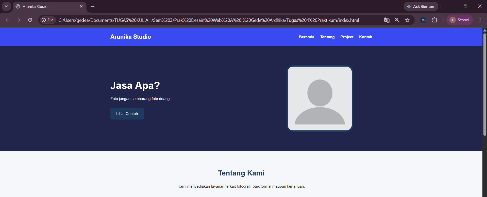
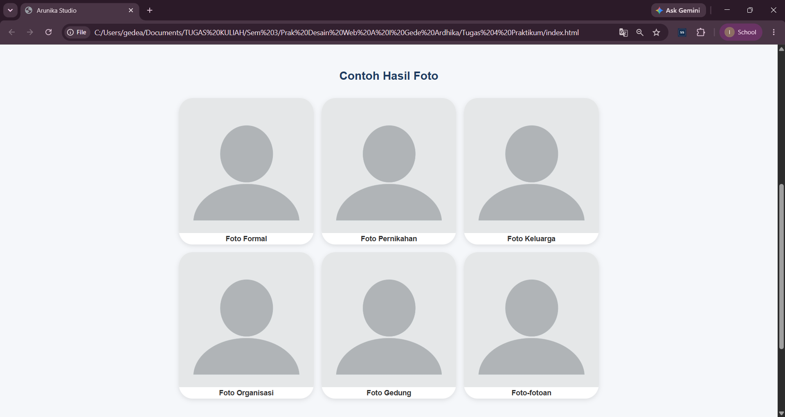
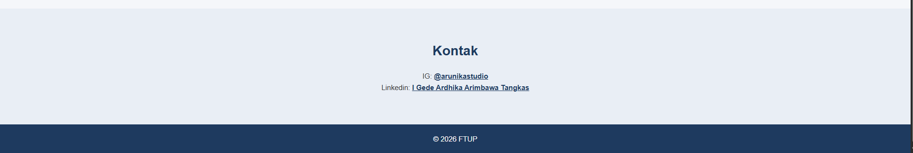
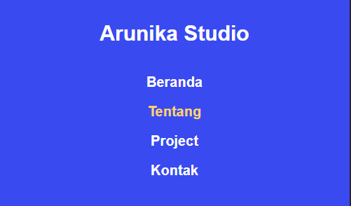
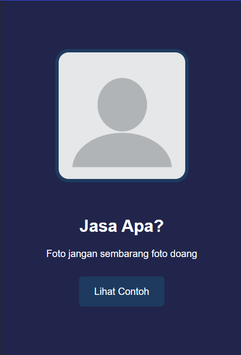
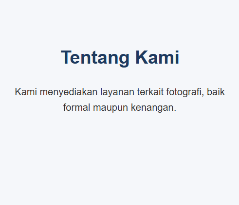
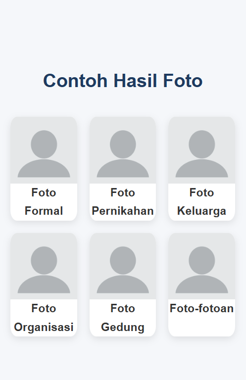
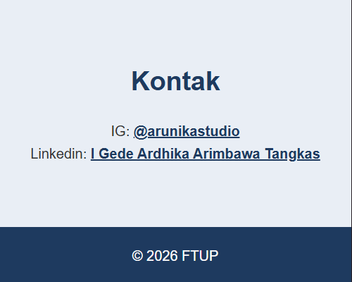

# LAPORAN PRAKTIKUM Desain Web

| Informasi Praktikan | Keterangan |
| :--- | :--- |
| **Nama** | I Gede Ardhika Arimbawa tangkas |
| **NPM** | 4525210080 |
| **Kelas** | A |
| **Mata Kuliah** | Desain Web |
| **Pertemuan** | 4 - CSS Lanjutan |

# 1.Kesimpulan Kodingan

Website landing page “Arunika Studio” ini dibangun dengan HTML dan CSS murni. Strukturnya terdiri dari header dengan navigasi, hero, tentang, project (enam kartu galeri jenis foto), kontak, dan footer. CSS tertata rapi per bagian dengan komentar pembatas, memakai Flexbox untuk tata letak, scroll-behavior: smooth untuk navigasi halus, serta media query untuk tablet (768px) dan smartphone (480px).

## 1.1. Masalah yang Ditemukan

>Link kontak/footer tidak berfungsi. Pada awalnya link rusak karena kesalahan penulisan. Sebelum dibenarkan, link LinkedIn masih ditulis www.linkedin.com/... tanpa https://, sehingga dianggap path relatif.

>Class tidak sinkron. HTML memakai project-card-one, tetapi sebagian CSS (hover, img, h3, p, dan media query responsif) masih memakai .project-card, sehingga gaya tersebut tidak berlaku. Akibatnya, gambar tidak seragam, efek hover mati, dan kartu tidak menyesuaikan di layar kecil.

>Kesalahan lain: path CSS css/style.css tidak cocok dengan lokasi file pada saat pembuatan awal.

>Saran: samakan nama class, perbaiki URL dengan https://, dan rapikan properti CSS yang keliru.

# 2. Hasil Run

## 2.1. Desktop

>Note: Untuk Desktop foto diambil pada level zoom 75%

**Hasil Run Header, Section Hero, dan Section Tentang:**

**Hasil Run Section Project/Foto:**

**Hasil Run Section Kontak dan Footer:**

## 2.2 Mobile

**Hasil Run Header:**

**Hasil Run Section Hero:**

**Hasil Run Section Tentang:**

**Hasil Run Section Foto:**

**Hasil Run Section Kontak dan Footer:**

